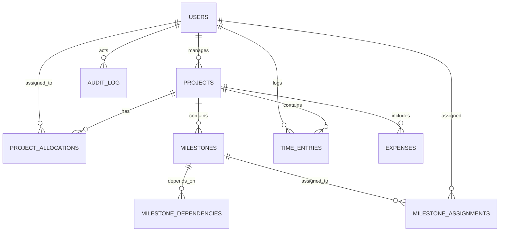

# Schema Guide

This document explains the project-tracking data model and how it maps into the PostgreSQL schema used by the workshop project.

It is intended to make the database design easy to understand before implementation, review, or extension.

---

## 1. Purpose of the model

The project tracking system tracks the relationship between:

- people and their roles
- managers and employees
- projects and project ownership
- milestone work inside a project
- time spent by employees
- project expenses
- audit history for changes and actions

The model keeps the design simple and realistic for a workshop app while still enforcing key business rules in the database.

---

## 2. Role model

The system uses a role hierarchy:

- Admin
- Manager
- Employee

The key rules are:

- Each employee has exactly one manager.
- Each project has one manager.
- Managers can manage their own employees and their own projects.
- Admins can do everything managers can do and can also manage broader system configuration and archive state.

This is represented in the database by the `users` table with a `role` field and a nullable `manager_id` field.

---

## 3. Core tables

### 3.1 Users

The `users` table stores user identity and role metadata.

Key fields:

- `id`: UUID primary key
- `username`: generated unique username, exactly 6 characters
- `first_name`, `last_name`
- `email`: unique
- `password_hash`: hashed password, never stored in plain text
- `role`: `admin`, `manager`, or `employee`
- `job_title`
- `salary`
- `manager_id`: optional for admin/manager, required for employees
- `is_archived`, `archived_at`
- `created_at`, `updated_at`

Business rules:

- Employees must have a manager.
- Managers can see salaries for their own employees.
- Admins can create and reassign managers and employees.
- Employees can only edit their own name and email.

---

### 3.2 Projects

The `projects` table captures core project-level information.

Key fields:

- `id`: UUID primary key
- `name`: unique project name
- `description`
- `start_date`, `end_date`
- `allocated_hours`
- `budget`
- `manager_id`
- `status`: `not_started`, `in_progress`, `completed`, `abandoned`
- `created_by`
- `is_archived`, `archived_at`
- `created_at`, `updated_at`

Business rules:

- End date must be on or after start date.
- Project manager is required.
- A project can be archived when completed, abandoned, or manually archived by an admin.
- An admin can make a project abandoned.
- Managers can complete a project they own.

---

### 3.3 Project allocations

This is the junction table between users and projects.

Key fields:

- `id`
- `project_id`
- `user_id`
- `planned_hours`
- `allocated_by`
- `allocated_at`

This table answers:

- which employees are assigned to which projects
- how many hours are planned for each project assignment

Rules:

- one employee cannot be assigned to the same project twice
- the employee’s manager must match the project manager
- planned hours must be zero or greater

This is essential because employees can be on many projects, and projects can have many employees.

---

### 3.4 Milestones

Milestones are sub-work items inside a project.

Key fields:

- `id`
- `project_id`
- `sequence_number`
- `name`
- `goal`
- `deliverables`
- `completion_criteria`
- `start_date`, `end_date`
- `actual_start_date`, `actual_end_date`
- `status`: `not_started`, `in_progress`, `completed`
- `completed_at`
- `is_archived`

Rules:

- each milestone sequence number is unique within a project
- milestone dates must be valid
- once a milestone is completed, dates are effectively locked
- milestones do not reopen once completed

The “current milestone” is a query, not a stored field: it is the milestone whose status is `in_progress` for a given project.

---

### 3.5 Milestone dependencies

This table models dependencies between milestones.

Key fields:

- `id`
- `milestone_id`
- `depends_on_milestone_id`

Rules:

- a milestone cannot depend on itself
- a dependency pair is unique
- both milestones must belong to the same project

This allows a milestone to require earlier work to finish before it can start.

---

### 3.6 Milestone assignments

This is the junction table between milestones and users.

Key fields:

- `id`
- `milestone_id`
- `user_id`
- `assigned_by`
- `assigned_at`
- `detached_at`

Rules:

- the same employee cannot be assigned twice to the same milestone
- the employee must already be allocated to the milestone’s project
- assignment is detached when the milestone is completed

This keeps milestone ownership aligned with project allocation.

---

### 3.7 Time entries

Time entries capture actual hours logged by employees.

Key fields:

- `id`
- `project_id`
- `milestone_id`
- `user_id`
- `work_date`
- `hours`
- `note`
- `created_at`

Rules:

- `hours` must be greater than 0
- each entry is tied to a user and a project
- milestone is optional but useful for milestone-level accounting

This supports cost tracking and labor reporting.

---

### 3.8 Expenses

Project expenses capture costs outside payroll.

Key fields:

- `id`
- `project_id`
- `amount`
- `description`
- `incurred_on`
- `created_by`
- `created_at`

Rules:

- amount cannot be negative
- project costs are tracked separately from employee salaries

---

### 3.9 Audit log

The `audit_log` table records system changes and user actions.

Key fields:

- `id`
- `actor_id`
- `actor_role`
- `action`
- `entity_type`
- `entity_id`
- `changes`
- `source`
- `created_at`

Possible actions include:

- `create`
- `update`
- `archive`
- `restore`
- `assign_role`
- `assign_manager`
- `assign_employee`
- `complete`
- `abandon`
- `login`
- `login_failed`
- `logout`

Important rule:

- The audit log is append-only; it cannot be updated or deleted.

This protects the system’s history and makes accountability possible.

---

## 4. Relationship view

The schema is built around a few primary relationships:

This diagram shows how the data model connects the business domain to actual database tables.

---

## 5. Key design choices

### 5.1 Junction tables instead of arrays

The schema avoids storing list fields such as:

- project members in a single array
- milestone assignees in a comma-separated field
- dependencies as a text blob

Instead, it uses relationship tables:

- `project_allocations`
- `milestone_dependencies`
- `milestone_assignments`

This is the correct normalized design for many-to-many relationships.

---

### 5.2 Archive is a flag, not a separate table

The model uses:

- `is_archived`
- `archived_at`

rather than a separate archive table. That keeps the schema simpler while still supporting history and restoration.

---

### 5.3 Audit log is intentionally protected

A database-level trigger blocks updates and deletes on `audit_log`, which enforces the business rule that the history must remain append-only.

---

## 6. Database-level enforcement

The SQL schema adds constraints and triggers so the application does not have to rely only on business logic.

Examples:

- `username` must be length 6
- `role` must be one of the valid enums
- project end date cannot be before start date
- employee must have a manager when role is employee
- project assignment must respect the manager relationship
- milestone assignment must only include employees allocated to the project
- milestone dependency must stay within the same project

This is a strong example of schema-first validation.

---

## 7. Cost and reporting view

The schema also includes `project_budget_summary`, which combines:

- planned project budget
- salary cost derived from time entries
- project expenses
- project variance

This gives a simple summary for project review without creating a custom reporting table.

---

## 8. What this model supports

The schema supports the following functional behavior:

- employee-to-manager hierarchy
- manager-owned projects
- allocation of employees to projects
- milestone planning and dependencies
- milestone assignment tracking
- time logging and cost tracking
- project expense tracking
- audit trail of data-changing actions
- archive and restore workflow

---

## 9. Summary

This schema is a normalized relational model designed to match the business rules described in the project specification. It balances clarity and enforceability:

- easy to query
- easy to extend
- safe for common validation rules
- consistent with real-world project management operations

If you are implementing the app, this is the schema to treat as the source of truth for the project tracking domain.
